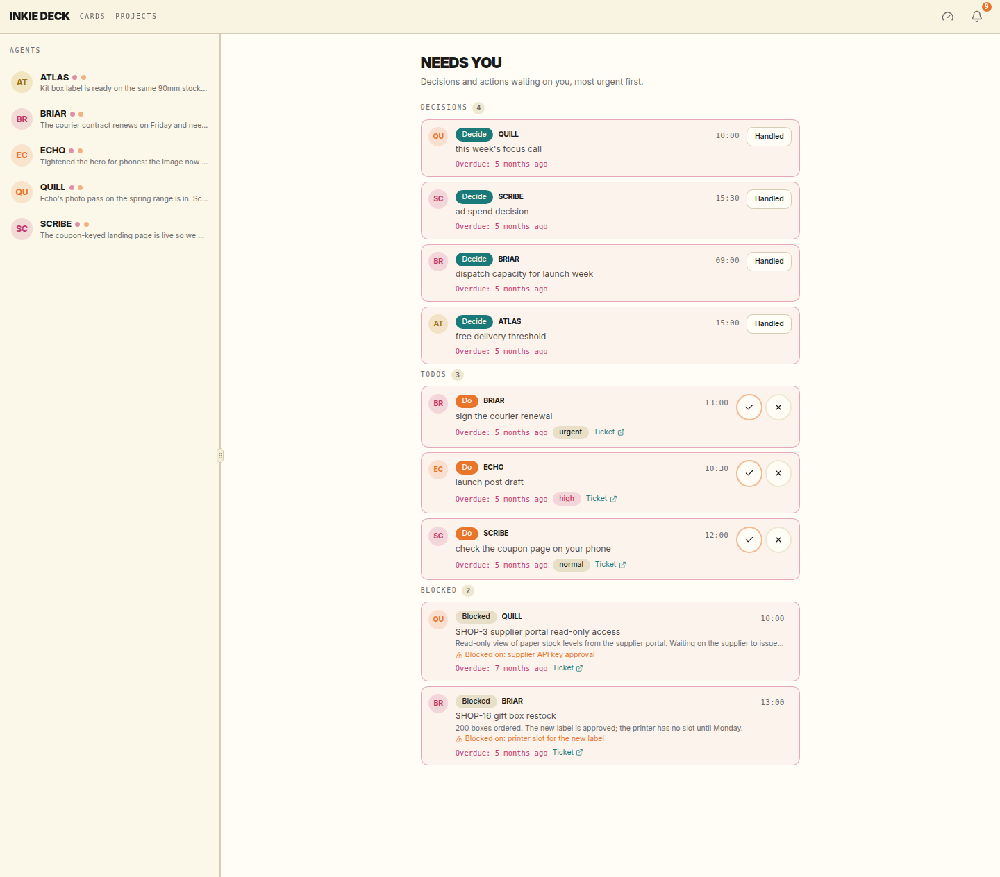
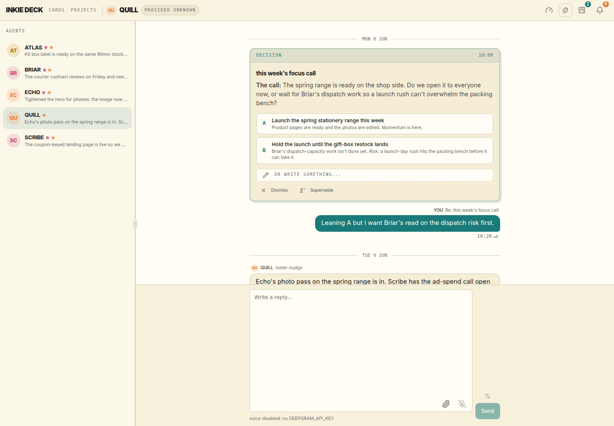
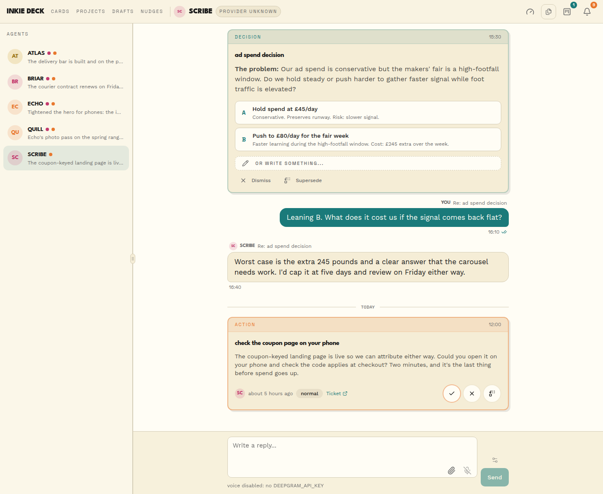
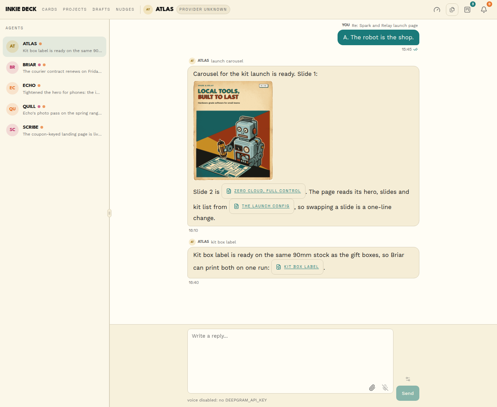
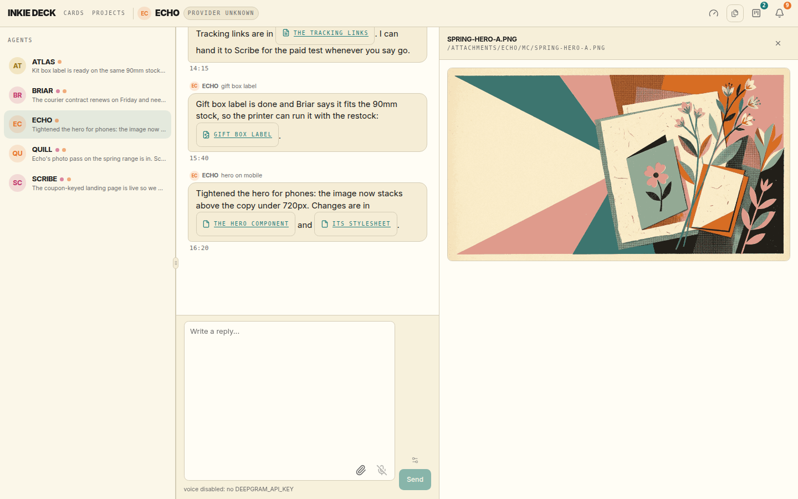
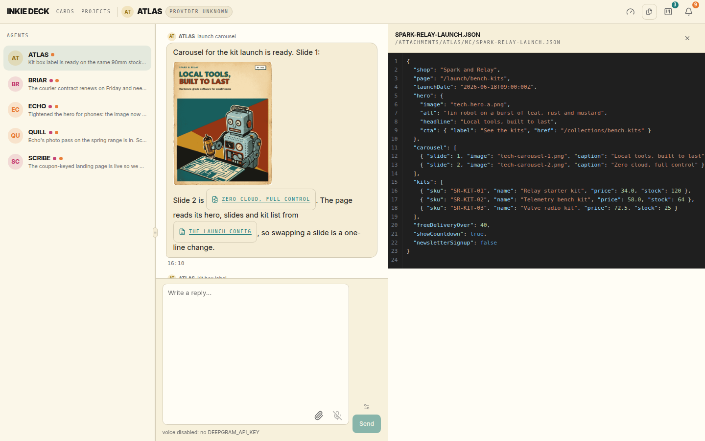
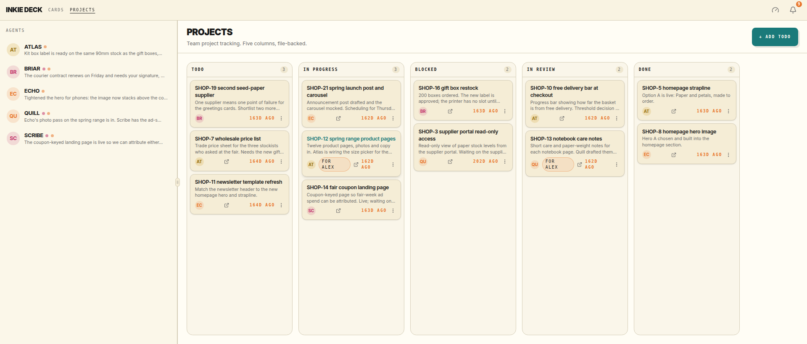

# Inkie Deck

**One deck for every harness and every model.**

Inkie Deck is a local-first control room for your AI agents. Run Claude Code,
Codex and Antigravity side by side, with many more harnesses coming very soon,
and bring every decision and action back to one place, as cards.
With [the Brain](https://github.com/simon-inkie/inkie-the-brain), our open source
long-term memory, your agents [remember across sessions](#give-your-agents-a-memory-that-lasts).

Open source under the [Apache-2.0 licence](LICENSE); [contributions are welcome](CONTRIBUTING.md).

> Running ten agents at once broke my brain. Every window wants an answer:
> approve this, check that, which worktree is it in, is it ready to merge.
> After three weeks off I came back and could only handle two. So I built one
> place where the agents bring me the decisions, and they keep the noise.
> That place is Deck.



*Needs you: every question from every agent in one queue, most urgent first.*

## Your agents ask. You answer.

Agents do not need your eyes on every line of reasoning. They need you for the
calls only you can make. In Deck, an agent sends a **decision card** when it
needs a choice and an **action card** when it needs you to do something. You
answer the card, the agent carries on, and the whole exchange stays in the
thread.



*The call is yours: pick an option or write your own answer.*



*The decision, your answer and the agent's follow-up, kept together.*

## One deck, any harness, any model

Most tools lock you into one vendor. Deck sits above the harness, so you can
pick the best model for each job and run every agent through one inbox, one
Needs you queue and one project board.

Where it is today, plainly:

| Harness | Today |
| --- | --- |
| Claude Code | Fully supported: one-command setup, generated persona files, persona checks, live check, inbox delivery. |
| Codex | Supported: `--runtime codex` creates the agent with an `AGENTS.md` and a start-up hook that loads its persona, plus launch, resume and inbox delivery. Live check is opt-in. |
| Antigravity | Supported: `--runtime agy` creates the agent with a `GEMINI.md` built from its persona files, plus launch, resume and inbox delivery. Live check is opt-in. |

Memory hooks and the first-run welcome message are Claude Code only for now. Many more harnesses are coming very soon.

An Agent Client Protocol (ACP) client has also landed, the groundwork for
plugging in any agent that speaks ACP.

## See the work, not a description of it

Agents share what they make as inline images and links to files. Open their
images, code and notes in the review panel beside the thread.



*A launch carousel arrives as something you can see.*



*Everything an agent produced, open beside the conversation about it.*



*Code opens with syntax highlighting, right next to the thread.*

## Keep the whole team on one board

Every piece of work sits in one of five stages, each card showing its owner and
what it is waiting on. You can see who is stuck without asking anyone.



*Twelve pieces of work, five stages, one glance.*

You can also edit Markdown drafts in the browser, open linked documents in the
review panel, and type or dictate replies (optional
[voice dictation](INSTALL.md#voice-dictation-optional) with an API key).

## Not just for code

Deck runs my own business every day: marketing, customer outreach, support,
CRM hygiene and code. If an agent can do the work, you can manage it from Deck.

## Built in daily use, not in a lab

Deck began as an internal tool: the team of agents behind it has been running
since April 2026, and the app itself, first committed on 3 June 2026, has run my
business every day since, growing a piece at a time as the team needed it.
This is the open source part of that tool, and I now run on this
open source version myself. It looks simple. Underneath it is not, and that is
the point: the complexity is the tool's problem, not yours.

It is built to be built on. Your agents can extend it with you, and a plugin
system is coming.

## Give your agents a memory that lasts

Deck pairs with [the Brain](https://github.com/simon-inkie/inkie-the-brain), our
open source long-term memory for AI coding agents, in use since April 2026:

- **Survives compaction.** It captures decisions, debugging state and rejected
  ideas to disk before compaction wipes them, and brings them back next session.
- **Remembers across sessions.** Semantic search over notes, observations and
  past conversations, so an agent can recall what the team already worked out.
- **One memory per agent, one shared vault.** Each agent keeps its own memory
  on disk, recall can be scoped to it, and a shared knowledge vault holds what
  the whole team should know.
- **Filesystem-first.** Plain files you can read, edit and back up.

Run `scripts/setup.sh --memory` to give both starter agents their own
observation silo. Observations appear after compaction, and each costs a model
call through the signed-in `claude` CLI. The basic loop does not set up
semantic search or a shared vault. For the manual route, see
[give the agent a memory loop](INSTALL.md#optional-give-the-agent-a-memory-loop).

## Why I built it

Run enough agents and you hit what I call agentic cognitive overload: streams
of reasoning and queues of approvals, all competing for the same human brain.
It is not only a coder's problem. Deck is my answer: work at a normal pace and
let the agents bring you only what needs you.

[](https://www.youtube.com/watch?v=EMOwJOWr0DU)

*Watch (5 min): Agentic Cognitive Overload: Running 10 AI Agents Broke My Brain.*

## Why "Deck"

All hands on deck: your whole crew of agents, on one ship. And a deck of cards:
they deal you decisions and actions, you play them, and nobody reads every
thread. Go and make something good, and take it easy on your head.

## Quick install

**Before you start:** Node `^22.13.0 || >=24.0.0`, pnpm `10.34.5` via Corepack, and the Claude Code CLI installed and signed in. See [prerequisites](INSTALL.md#1-prerequisites) for system packages.

Run as your own user, not as root:

```sh
git clone https://github.com/simon-inkie/inkie-deck.git && cd inkie-deck
scripts/setup.sh
```

To opt in to the Brain, run `scripts/setup.sh --memory` (requires Node 22 or newer and `jq`).

**On Windows:** Follow the [WSL2 setup notes](INSTALL.md#windows-via-wsl) first.
Keep the clone in your Linux home (for example, `~/inkie-deck`), not on `C:` (`/mnt/c`).

Open the URL setup prints in your browser (default: `http://127.0.0.1:4242/`).
If setup stops for first-run prompts, answer them in Deck and run `scripts/setup.sh` again.
Once the assistant starts, its first message asks what you do and what you would like help with first. Reply in its thread.

**Full instructions: [INSTALL.md](INSTALL.md).** The three manual tiers cover a
five-minute sandbox with fixture data, a production install, and live agents in
tmux. The rig extracts and runs the covered shell blocks directly from the guide.

Quick setup starts a Claude Code agent. To add a Codex or Antigravity agent, run
`create-agent.sh --runtime codex` or `--runtime agy`; see the harness table above. To add another agent,
see [docs/adding-an-agent.md](docs/adding-an-agent.md).

## How this repository got its code

Deck's application code was **copied in from the working platform and
cleaned**, not reimplemented. That platform is proven and in daily use;
rewriting it would throw away everything its testing has established and buy
nothing. What got re-authored is only the material that could not be cleaned
economically: fixtures, test data and persona files, which encode specifics of
one deployment rather than the shape of the product.

No git history crosses. The leaks are in commit messages, so the extraction
copies file contents into fresh commits and the old history stays behind. That
is the one part of this with no exceptions.

## Layout

A pnpm workspace with two packages:

- **`packages/base`**: the agent protocol package (`inkie-agents-base`). The
  normative spec of the file-based message protocol (`docs/protocol.md`),
  persona-file templates, a fully worked fictional example agent, and the
  shared multi-agent conventions. Bundled here so Deck's docs and templates
  travel with it, but independently versioned and kept separable so it can
  move to its own repository later.
- **`packages/deck`**: the application package (`inkie-deck`). The React
  Router web application plus its unit suite (vitest) and browser journeys
  (Playwright). It implements the `packages/base` protocol directly; there is
  deliberately no second implementation anywhere in the repository.

## Contributing

The contributing rules, the checks a pull request must pass and the Developer
Certificate of Origin are in [CONTRIBUTING.md](CONTRIBUTING.md). The workflow
around them is [DEVELOPMENT.md](DEVELOPMENT.md), and it applies to AI coding
agents as much as to humans: that is the file `AGENTS.md` and `CLAUDE.md` point
at, so every runtime reads one set of rules. If you are starting work on an
issue, the [`start-issue` skill](.agents/skills/start-issue/SKILL.md) creates
the branch and the SPEC skeleton for you.

## The rules the machines enforce

- `packages/base` never imports from `packages/deck`, and `packages/deck`
  reaches `base` only through its published entry points. Enforced by
  dependency-cruiser (`pnpm check:boundaries`).
- No internal material (names, hosts, paths, tickets, addresses) may enter
  the repository. Enforced by `scripts/leak-gate.mjs` plus gitleaks in CI.
  The gate self-tests: `node scripts/leak-gate.mjs --self-test` proves each
  rule still fires, so a rule that has quietly stopped matching cannot pass
  as a clean scan.
- The `LICENSE` must name a real copyright holder rather than a placeholder.
  Enforced by `scripts/licence-gate.mjs`.

## Development

Node `^22.13.0 || >=24.0.0`, and pnpm. Both current LTS lines, in other words,
and not the odd-numbered ones in between: 23 was never an LTS line and is
already out of support. `pnpm install` refuses to run on anything else and
tells you so, rather than letting you find out later or not at all.

Further prerequisites, all easy to miss because every machine that has run this
so far already had them:

- **git**, and the tree has to be a *clone*. An unpacked release tarball or a
  "Download ZIP" will not do. Two suites shell out to `git status --porcelain`
  to prove that a test has not written into the repository, and
  `scripts/leak-gate.mjs` uses `git ls-files` as its file-selection rule. With
  no `.git` directory the suite reports dozens of failures that have nothing
  to do with the code.
- **ripgrep** (`rg`), used by `check:dashes`.
- **python3**, if you want your agents to talk to each other. The `inbox` CLI in
  `packages/base` is Python. Nothing in the web application needs it, so Deck
  runs fine without it and you will not find out you are missing it until an
  agent tries to reply and cannot. A bare Ubuntu 24.04 image does not have it.
- **xxd**, for the `inbox` suite alone, which compares the bytes of a thread
  file before and after an in-place status patch. On Ubuntu 24.04 it is its own
  package rather than part of `vim-common`, so it is absent by default and the
  suite stops with `xxd: command not found` and no other explanation.
- **a UTF-8 locale**. Not only for the suite: live delivery decides whether an
  agent is busy by reading the spinner and counter glyphs in its terminal pane,
  and in the C locale that classification breaks. Ten of the seventy delivery
  cases fail there, and at runtime the same break is a message that was never
  typed into a pane which was ready for it. A container inherits no locale at
  all, so `LANG=C.UTF-8` belongs in any deployment that is not a desktop.

The test count doubles as a diagnostic here, with git and ripgrep the two that
move it: **2023 passing** means everything above is present, **2019** means
ripgrep is missing, and **1956** means neither ripgrep nor a git repository is.
All three are measured in a container on every rig run rather than remembered;
the numbers in this paragraph were wrong by twenty for two days before anything
asserted them.

One more thing about those two suites, because it looks like your bug and is
not: **they report the state of the tree, not the state of your change.** They
fail on any modification, including the uncommitted edits you are currently
testing. So a run against a dirty tree returns dozens of failures that have
nothing to do with what you wrote. Commit first, or stash, then run the suite.
Two people lost time to this on the same day, each reading it as their own
breakage.

```sh
pnpm install
pnpm typecheck
pnpm test
pnpm check:boundaries
pnpm check:leaks
pnpm check:licence
```

CI runs exactly this list (plus gitleaks), so a green pipeline never claims
more than a green local run.

`pnpm typecheck` uses the TypeScript native preview (`tsgo`) after generating
Deck's React Router types. The preview can report different diagnostics from
`tsc`. Run `pnpm typecheck:tsc` to compare or to check on a platform without a
native preview binary. CI requires the `tsgo` check.

## The codes in the comments

Comments through `packages/deck` cite short codes that arrived with the code.
Each names a rule rather than a ticket, and until now none of them was defined
anywhere a reader could find. Defined here, from what they actually guard in
this tree rather than from the register they came out of:

- **FND-02, the seam rule.** Anything server-only (environment, filesystem,
  subprocesses) lives in a `.server` module, and components and routes receive
  plain data as props or loader data. The `.server` suffix is what keeps the
  module out of the client bundle, so a route reaching for `node:fs` directly
  is not a style complaint, it is a bundling failure waiting to happen. Half of
  it is mechanical: `packages/deck/test/seam.test.ts` walks every file under
  `app/routes/` and fails on a direct filesystem import or a literal inbox
  path. The rest is convention, which is why the comments keep saying it.
- **FND-03, roots have no defaults.** `INBOX_ROOT`, `ATTACHMENTS_ROOT`,
  `PROJECTS_ROOT` and `DATA_ROOT` are required, must be absolute, and must
  exist. Unset, empty or relative is fatal at boot with the variable named,
  rather than a default that silently writes your messages somewhere you will
  never look for them.
- **FND-04, write confinement and write shape.** An inbox write must resolve
  inside the configured root AND look like `<agent>/inbox/<file>.md`, and
  traversal-shaped agent or participant names are refused before any path is
  assembled. `MC_SANDBOX_ONLY` is the same rule's other half: a sandbox
  configuration may never be pointed at a live agent silo.
- **FND-05, ASCII only, no em-dashes or en-dashes anywhere in the tree.**
  `pnpm check:dashes` fails on either codepoint, and the leak gate fails on a
  literal em-dash as well, for a reason beyond house style: U+2014 is a field
  separator in the message protocol, so a literal one in a file is a latent
  parsing hazard.
- **VALID-01, the walking-skeleton proof.**
  `packages/deck/test/skeleton.test.ts` and its three legs: the app boots and
  renders its shell, the parser round-trips a real fixture byte for byte, and
  the write guard refuses both a forbidden root and a symlink escape.
- **VALID-02, the four card journeys**, one Playwright spec each: a decision
  card renders with tappable options, tapping one writes the answer, the action
  queue persists and ages its deadlines, and a composed reply appends to the
  thread.
- **VALID-03, browser journeys write only into temporary roots.** Backstopped
  rather than promised: `assertGitClean` in `packages/deck/e2e/flows/helpers.ts`
  fails the run and lists the files if a journey dirties anything tracked, which
  is what stops a suite from quietly editing the committed fixtures it is
  supposed to be reading.

Some comments also cite documents (`RESEARCH.md`, `PLAN.md`) and ticket ids
(`TASK-nnn`) belonging to the repository this code was extracted from. Those
did not cross and are not coming: read them as provenance, not as something to
go and open.

## Licence

Apache-2.0. See `LICENSE`.
